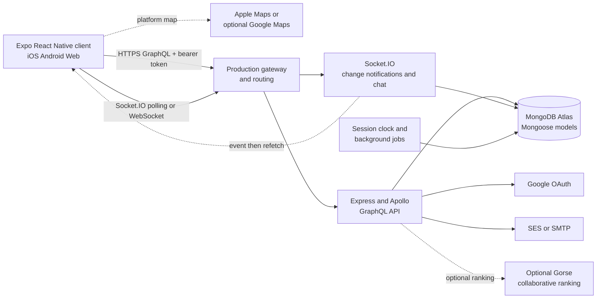

# FieldDay System Explanation

FieldDay is a mobile-first application for finding and organizing local pickup
sports sessions. Its central design problem is not only finding an event; it is
keeping the event trustworthy as people discover it, join it, attend it, and
rate the experience afterward.

This document explains how the system is organized and why its major parts fit
together. Use the [Tutorial](tutorial.md) for a guided first workflow, the
[How-To Guide](how-to.md) for task procedures, and the
[Reference](reference.md) for exact operations, configuration, and schemas.

## System Overview

FieldDay has four important boundaries:

- The Expo/React Native client presents authentication, onboarding, discovery,
  sessions, friends, chat, notifications, and profile workflows on iOS,
  Android, and web.
- The Node.js backend exposes the application contract through GraphQL and
  applies identity, visibility, membership, lifecycle, and rating rules.
- MongoDB, accessed through Mongoose, is the source of truth for users,
  sessions, relationships, messages, notifications, and authentication
  sessions.
- Socket.IO provides timely change notifications. It does not replace
  GraphQL as the authoritative, access-controlled data path.

The system also integrates with external services for email delivery, Google
OAuth, maps, and optional recommendation ranking. These services are kept
outside the core data model so the application can continue to provide its
main session workflow when an optional integration is unavailable.

## Architecture and Data Flow

The local application runtime and the production network topology are related
but should not be treated as the same diagram. Locally, Express, Apollo,
Socket.IO, and the background jobs share one Node.js process and HTTP server.
In production, the API can be reached through the deployed gateway and its
configured routing layer.

The client sends GraphQL requests through `frontend/src/api.js`. When a token
exists, the client places it in the `Authorization` bearer header. The backend
authenticates that token before constructing `context.currentUser`, which is
then used by resolvers. The backend never treats a client-supplied user ID as
proof of identity.

Socket.IO shares the backend's HTTP server and listens on `/socket.io`. A
session event contains only the session ID, a reason, and a timestamp. The
client refetches the session through GraphQL after receiving the event. This
keeps the event channel small while ensuring that the response still passes
through the same authorization and visibility checks as any other request.

## Core Domain Model

The domain is organized around a session and the people who participate in it.

### Users and profiles

Users have authentication data, sports, per-sport skill levels, availability,
social ratings, friends, notification preferences, and optional profile media.
Authentication sessions store token hashes rather than reusable plaintext
login tokens. Profile media is held separately from the user document so
uploads can be validated and expired when they are not attached.

### Sessions and rosters

A session has a host, sport, start and end times, location, a capacity, a
roster, a visibility mode, and lifecycle information. The host is added as the
first participant. A session can be `PUBLIC`, `FRIENDS`, or `INVITE_ONLY`.
Visibility is enforced by the API, not only hidden in the interface.

Joining is an atomic database update that checks capacity while adding the
participant. This matters because two stale clients may both see one open
spot, but only one update can claim it. Leaving removes the participant with a
separate `$pull` update so a concurrent join is not accidentally overwritten.

### Social and communication data

Friend requests and friendships support discovery and friends-only sessions.
Conversations can be direct or associated with a session. Messages use a
client-generated message ID with a uniqueness constraint, making retries
idempotent. Notifications are persisted per user, while device tokens and
preferences are stored separately for delivery and category controls.

## Identity, Authorization, and Persistence

The application uses a deliberate flow for protected operations:

1. The client stores its authentication token using the frontend's token and
   secure-storage utilities.
2. The client sends the token in a bearer header for GraphQL or in the
   Socket.IO handshake.
3. The backend verifies the token and resolves the corresponding user into
   `context.currentUser` or the authenticated socket.
4. Resolvers apply ownership, membership, visibility, and lifecycle rules.
5. Only after those checks do resolvers read or mutate Mongoose models.

This server-derived identity prevents a caller from changing another user's
profile, rating someone else's session, or joining a private conversation by
simply replacing an ID in a request. The same principle is applied to
realtime access: a socket's private event rooms are built from the verified
user and the session's visibility.

Browser requests are additionally checked against configured origins. Native
clients do not send a browser `Origin` header and rely on bearer
authentication. Secrets such as database credentials, OAuth configuration,
email credentials, and Gorse keys remain backend configuration rather than
frontend environment values.

## Session Lifecycle and Consistency

The lifecycle is intentionally driven by server time and guarded mutations.
The host creates a session, and the host becomes its first participant. Before
the start time, eligible users can join or leave subject to visibility,
capacity, membership, and cooldown rules. Hosts can edit or cancel their own
sessions, while ordinary participants cannot change session ownership or
capacity.

Except for cancellation, session status is derived from `startsAt` and
`endsAt`. A backend clock check runs every 30 seconds and publishes start or
end notifications. Background processing also handles invalid sessions,
no-show rating settlement, and related notifications. This avoids requiring a
user to perform a manual “complete” action, but it means deployed instances
must run the clock and coordinate jobs when multiple servers share a database.

Attendance is now inferred by participation. The schema retains
`checkInToSession` for compatibility with older app builds, but the resolver
rejects it because location check-in was removed. After a session ends,
participants can report other participants as no-shows during the reporting
window. Those reports feed automatic ratings and the social cooldown policy.

This is a current implementation detail that differs from the original
project specification. The older requirement and historical documents should
not be read as evidence that location check-in is still supported.

## Discovery and Recommendations

Session discovery begins with GraphQL queries that filter for eligible future
sessions. MongoDB's GeoJSON `2dsphere` index supports distance filtering, and
additional indexes support common sport, time, participant, invite, and
no-show queries.

The default recommendation path is deterministic and explainable. It combines
the user's sport preferences and skill with the session's skill band, open
spots, start time, and optional distance. Each result can include plain-language
reasons, which makes the ranking inspectable for a new user and useful when
there is little historical activity.

An optional self-hosted Gorse service can add collaborative signals as users
join sessions and view recommendations. MongoDB remains the source of truth;
if Gorse is unavailable or has no useful ranking, the deterministic fallback
continues to work. Gorse receives pseudonymized IDs and limited attributes,
not passwords, email addresses, precise coordinates, or authentication
tokens. The legacy Shaped export is an optional or historical data path, not
the default recommendation engine.

This design trades some ranking sophistication for predictable cold-start
behavior, lower operational coupling, and a graceful failure mode. Availability
is currently stored at a broad weekday and time-of-day level without a
timezone, so it is intentionally not used as a recommendation signal yet.

## Realtime Synchronization

Realtime is an invalidation mechanism rather than a second database API. When
a session is created, edited, joined, left, cancelled, started, or ended, the
server emits `session:updated`. The payload does not include roster contents
or participant identity. Clients refetch the protected session through
GraphQL, which avoids duplicating authorization logic in event payloads.

Public session events can be broadcast. Events for friends-only and invite-only
sessions are sent only to the host, participants, and the relevant friends or
invitees. A participant who has just left can still receive the event that
explains the change. Chat uses authorized conversation rooms on the same
Socket.IO connection.

When a connection drops, the client reconnects and refetches after resync. It
does not need to reconstruct state from every missed event. The connection
starts with HTTP long-polling and can upgrade to WebSocket. This makes the
system more tolerant of restrictive proxies, but a multi-instance deployment
still needs compatible routing and sticky sessions for polling connections.

## Security and Privacy Rationale

The most sensitive application data includes exact session coordinates,
participant lists, identities, authentication material, private messages, and
presence-related events. The architecture limits exposure in several ways:

- Resolver authorization is based on verified server identity and explicit
  visibility, ownership, and membership checks.
- Realtime events reveal only a change signal and use private user rooms for
  restricted sessions.
- Browser origins are checked for GraphQL and Socket.IO access.
- Authentication sessions store hashes and expire through database cleanup.
- Third-party recommendation data is minimized and pseudonymized.
- External credentials and secrets stay on the backend.

These controls reduce accidental disclosure, but they do not make an external
service automatically trustworthy. Optional services such as Gorse still need
private networking, TLS where applicable, least-privilege credentials,
rotation, and operational monitoring.

## Platform and Deployment Tradeoffs

React Native and Expo support the mobile-first use case: people use FieldDay
while moving between locations, and native integrations help with maps,
notifications, and secure storage. The project also exports to web, although
web behavior is not identical to native behavior. Apple Maps is the default
iOS provider to avoid requiring a Google key during ordinary iOS testing;
Google Maps is optional, and the web experience uses a text fallback where the
native map package is unavailable.

The backend keeps GraphQL and Socket.IO on one HTTP server so the core client
transport and live transport share authentication and deployment concerns.
MongoDB was chosen for document-oriented relationships, GeoJSON proximity
queries, indexes, and atomic roster updates. These choices make the core
workflow straightforward, while requiring care around index maintenance,
background-job ownership, and realtime routing as deployment scale increases.

Email verification and password recovery can use Amazon SES or SMTP. Google
OAuth and Gorse are optional boundaries rather than prerequisites for the
basic session lifecycle. The local Gorse Compose configuration is for
development and does not by itself provide a production deployment.

## Limitations and Evolution

The following limitations are important when interpreting the current system:

- Availability has no timezone and is not currently used for recommendation
  ranking.
- Web maps and some platform-specific behavior are fallback or partial
  implementations compared with native mobile behavior.
- Push delivery and latency are not fully measured across production
  environments, even though device tokens and in-app notifications exist.
- Legacy schema fields and compatibility operations may remain after a feature
  has been removed; their presence does not mean the behavior is active.
- Multi-instance Socket.IO deployment requires routing and session-affinity
  decisions that are not solved by the local server alone.
- Recommendation quality, geospatial behavior at scale, and external-service
  availability need continued production validation.

The original SDP, prototype documentation, and older diagrams are useful for
understanding intent and evolution, but they contain historical assumptions.
In particular, current implementation behavior takes precedence over older
claims about location check-in, mandatory Shaped recommendations, Google Maps
as the only map provider, and an absence of web support.

## Evidence and Document Boundaries

The implementation details behind this explanation are concentrated in
`backend/src/graphql/typeDefs.js`, `backend/src/graphql/resolvers.js`,
`backend/src/models/`, `backend/src/realtime.js`, `backend/src/index.js`,
`frontend/src/api.js`, and `frontend/src/realtime.js`.

Focused behavior evidence includes the authorization, session lifecycle,
membership, visibility, realtime, chat, cooldown, profile setup, attendance,
and recommendation/export tests under `scripts/` and `backend/test/`. The
[Realtime design](realtime.md), [recommendation design](recommendations.md),
[security review](security/security-design-review.md), and
[maps explanation](maps.md) provide deeper rationale for the corresponding
sections above.

This document explains why the system is shaped as it is. Exact API fields,
environment variables, collection summaries, and event payloads belong in the
[Reference](reference.md), while commands and user workflows belong in the
[Tutorial](tutorial.md) and [How-To Guide](how-to.md).