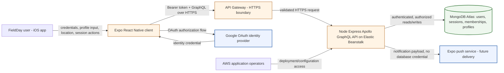
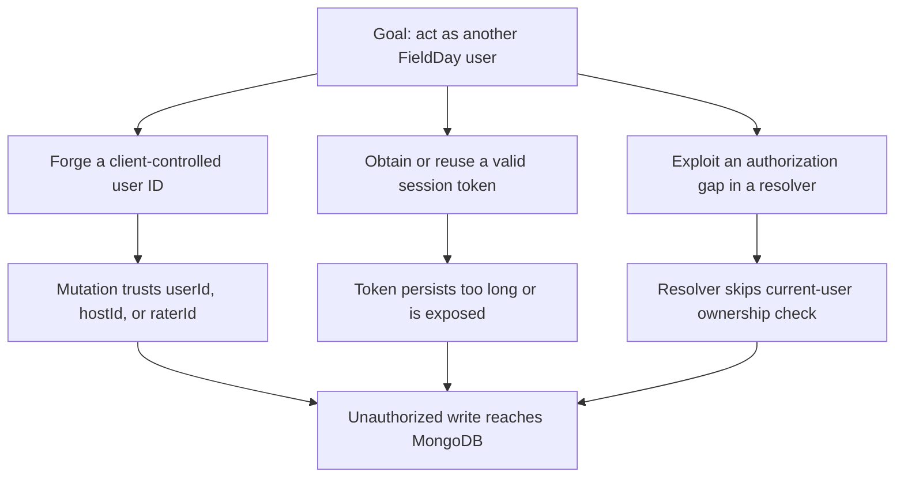
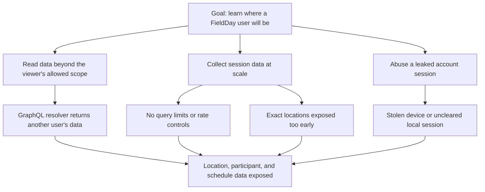

# FieldDay Security Design Review Evidence

This page holds the diagrams referenced by the team's Security Design Review submission. It is intentionally kept close to the deployed architecture so we can update it as the app changes.

## Data-flow diagram

**Trust boundaries.** User input reaches the mobile client first, but it remains untrusted until the API validates the request. The HTTPS edge between the app and API Gateway is a boundary because network traffic is outside our control. The backend-to-Atlas connection is another boundary because the API uses its database credentials and makes privileged reads and writes there. OAuth and push delivery are separate third-party boundaries; the mobile app should never hold their server secrets.

The most sensitive data is an account identity, email, authentication session/token, profile data, exact session coordinates, and participant lists. The location and participation data is especially sensitive because FieldDay is for in-person meetups. Unauthorized access could support stalking or harassment; unauthorized modification could let somebody impersonate a user, alter session membership, or manipulate ratings; denial of service could prevent people from seeing or joining a scheduled game.

## Attack tree 1: act as another FieldDay user

## Attack tree 2: collect users' session location and presence data

## Planned mitigation work

- [#201: Authenticate GraphQL requests and enforce the current user](https://github.com/pkarlsso/FieldDay/issues/201) moves authority from mutable client variables to a verified request identity. The GraphQL context and resolvers must derive the current user from a valid token, then check ownership/membership for profile, session, rating, friend, and report mutations. This is preventative. Integration tests should also intentionally try cross-user reads and writes, making them detective controls.
- [#200: Google sign-in and persistent FieldDay identity](https://github.com/pkarlsso/FieldDay/issues/200) provides the sign-in flow needed to issue and retain a real FieldDay identity without committing provider secrets into the Expo app. This is preventative.
- [#212: Verify NFR-2 transport, authorization, and data protection](https://github.com/pkarlsso/FieldDay/issues/212) records evidence that HTTPS is required, protected data is denied across user boundaries, secrets stay out of Git/mobile configuration, and Atlas encryption-at-rest is enabled. This is mainly detective, with automated authorization coverage used as regression protection.
- [#218: Add user-controlled profile and location visibility](https://github.com/pkarlsso/FieldDay/issues/218) puts location/profile visibility rules in GraphQL responses and persisted settings rather than just hiding fields in the UI. This is preventative.
